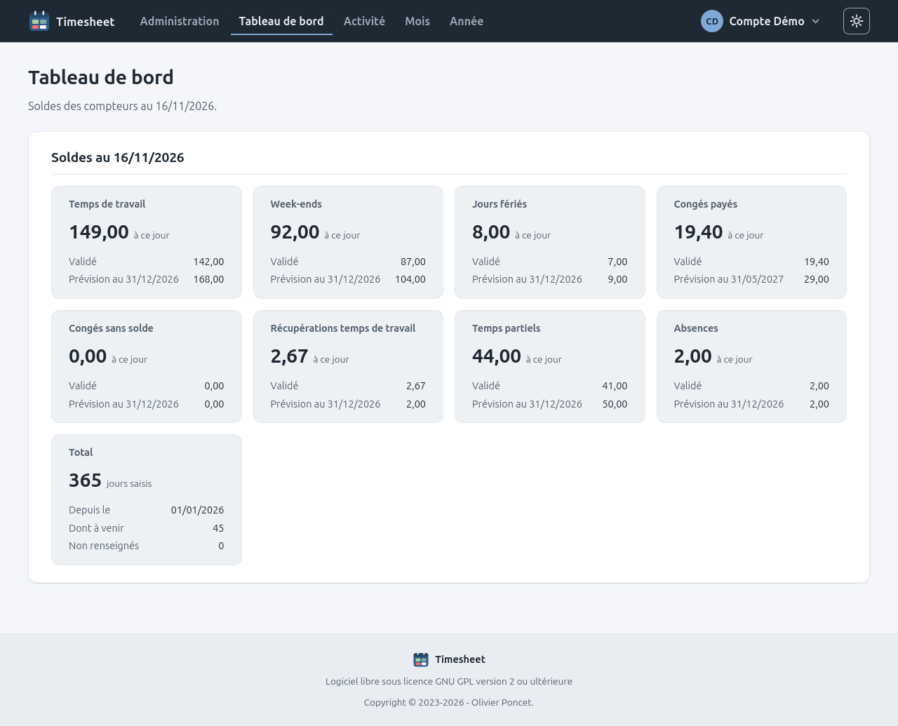
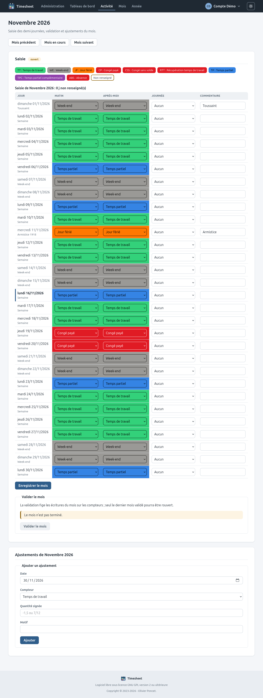
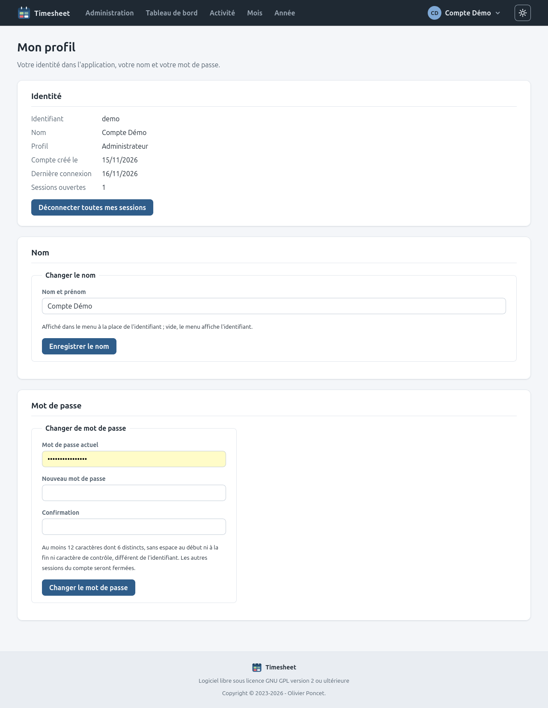
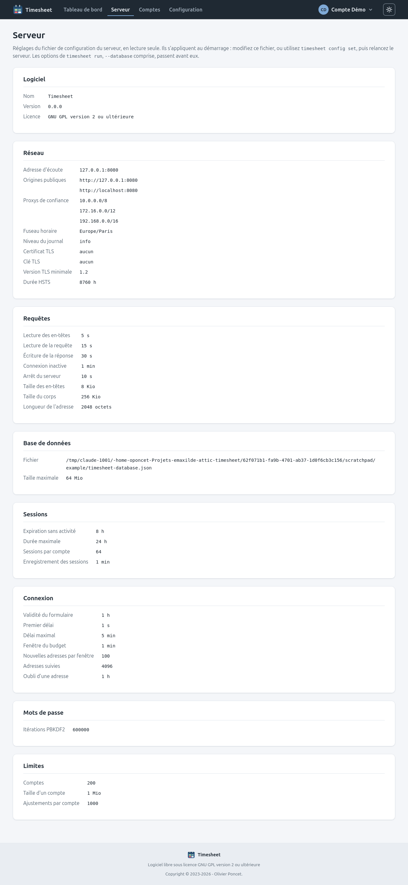
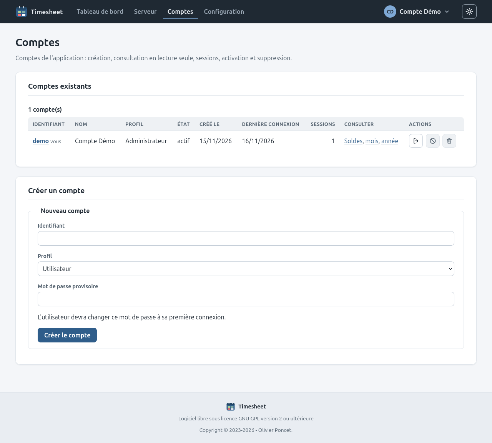
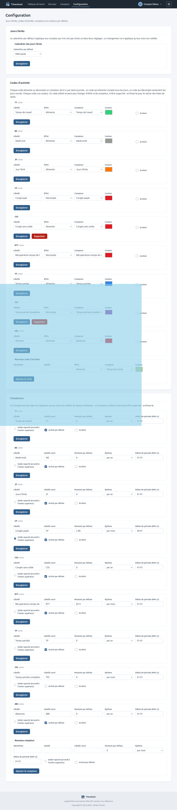

# USER GUIDE

This guide describes the daily tasks of an employee and of an administrator in Timesheet, and the meaning of the labels shown on screen.

Timesheet is your own record of your activity and your counters, kept independently of the tools of your employer, to compare with what the employer reports and with your payslips and to spot the gaps ([Why this application](SPECIFICATIONS.md#why-this-application)).

It is written for the people who use the application. Installing and running the server are described in the [README](../README.md); the complete rules are in [SPECIFICATIONS.md](SPECIFICATIONS.md).

## CONTENTS

- [CONCEPTS](#concepts)
- [ACTIVITY CODES](#activity-codes)
- [PAGES](#pages)
- [SCREENSHOTS](#screenshots)
- [ACCOUNTS](#accounts)
- [FOR THE EMPLOYEE](#for-the-employee)
- [FOR THE ADMINISTRATOR](#for-the-administrator)
- [LABELS ON SCREEN](#labels-on-screen)

## CONCEPTS

| Concept | Meaning |
| --- | --- |
| Half-day | Each day has a morning and an afternoon. Each holds one activity code. A day also has a free comment. Every day of the year is entered, weekends and public holidays included. |
| Activity code | What a half-day was, such as `TT` (working time) or `CP` (paid leave). The codes are listed in [Activity codes](#activity-codes). The list is configurable. |
| Counter | A balance in days, kept like a bank account: a journal of dated entries, a statement per month, a balance equal to the sum of the entries. |
| Feeding code | A code that credits its counter by half a day per half-day, on any day. Its counter simply counts days. |
| Consuming code | A code that debits its counter by half a day per half-day: leave taken from acquired rights. It is accepted on working days only (Monday to Friday, public holidays excluded). |
| Accrual | A credit of a counter, every month or every year. Paid leave accrues 2.08 days a month by default. An account can have its own amount, for instance 7/12 day a month of complementary part time. |
| Period end | At the end of its period, a balance is either carried over and rounded up to the whole day (paid leave), or reset to zero. |
| Adjustment | A dated, signed correction of a balance with a mandatory reason, for a gap with a payslip for instance. |
| Validation | A month that is over is validated like a bank statement: its counter entries are frozen. Only the last validated month can be reopened, then the one before. Reopening adds reversal entries: nothing is ever erased. |

Every term and acronym is defined in the [Glossary](SPECIFICATIONS.md#glossary).

## ACTIVITY CODES

The database starts with these codes and counters (from the configuration template `share/timesheet/database-template.json`). Each code names a counter of the same identifier.

| Code | Label on screen | Effect | Meaning |
| --- | --- | --- | --- |
| `TT` | « Temps de travail » | Feeds | Worked days. |
| `WE` | « Week-end » | Feeds | Weekend days. |
| `JF` | « Jour férié » | Feeds | Public holidays, and the days off entered like them, such as a bridge day. |
| `TP` | « Temps partiel » | Feeds | The weekly day off of a part-time contract (TP, temps partiel). |
| `CSS` | « Congé sans solde » | Feeds | Unpaid leave. |
| `ABS` | « Absence » | Feeds | Absences; the reason goes into the comment. |
| `CP` | « Congé payé » | Consumes | Paid leave (CP, congés payés). |
| `RTT` | « Récupération temps de travail » | Consumes | RTT days. RTT stands for réduction du temps de travail: days off granted for working beyond 35 hours a week. |
| `TPC` | « Temps partiel complémentaire » | Consumes | Complementary part-time days, managed like RTT. |

The public holidays are built in, for thirteen zones: « Métropole », « Alsace-Moselle » (Good Friday and 26 December in addition) and the overseas territories (the abolition of slavery in addition, at its local date, where it is a public holiday). The administrator chooses the default zone; each user may choose their own in « Réglages ». The public holidays name the rows of the grid, refuse leave (a consuming code) and are counted in « Jours fériés ».

## PAGES

| Page | Content |
| --- | --- |
| « Tableau de bord » | The balance of each counter today, its validated balance and a forecast at the end of its period. |
| « Activité » | The grid of a month (morning, afternoon, comment for each day), its validation or reopening, and its adjustments. |
| « Mois » | Consultation only: the totals of the month, its calendar, its summary and the statement of each counter. |
| « Année » | Consultation only: the totals of the year, the calendar, the summary of the calendar year and one section per counter. The summary is modelled on a spreadsheet: a carry-forward row « Report N-1 », one row per month and totals. |
| « Mon profil » | Identity, name shown in the menu, password, open sessions. |
| « Mes souscriptions » | Your AI subscriptions, those shared with you, and their shares with other accounts. Its menu entry is just below « Mon profil ». |
| « Assistant » | Questions on your data to an AI model, with the answers in Markdown and tables, and the actions it proposes for your confirmation. The entry appears once you can use an AI subscription. |
| « Réglages » | Tracking start, calendar of public holidays, counters enabled, own accrual amounts, initial balances, colours of the codes. Its menu entry is « Mes réglages ». |
| « Données » | Import of a file, export of your data in the same format, deletion of your data to start the tracking again. Its menu entry is « Mes données ». |
| « Administration » | For administrators: the software version and the server settings, read-only (« Serveur »), the accounts (« Comptes ») and the configuration of the default calendar of public holidays, the activity codes and the counters (« Configuration »). |

- The menu under the user's name shows the profile and leads to « Mon profil », « Mes souscriptions », « Mes réglages » and « Mes données ». It also logs out (« Se déconnecter »).
- For an administrator, the header shows « Administration » left of « Tableau de bord ».
- On the public pages, the arrow entering a door at the right of the header (« Se connecter » on hover) opens the login page « Connexion ».
- The button of the header switches between the light and the dark theme. The choice is kept in the browser only.

## SCREENSHOTS

The screenshots show the account `demo` of the [example database](OPERATIONS.md#example-database).

### Home

The public home page « Timesheet », shown before login.

### Login

The login page « Connexion »: login and password.

### Dashboard

The balance of each counter today, its validated balance and its forecast at the end of its period, and the total of the days entered.

### Activity

The grid of the month: a code for the morning and for the afternoon of each day, a comment, the validation of the month and its adjustments.

### Month

Consultation of a month: its totals, its calendar, its summary and the statement of each counter.

### Year

Consultation of a year: its totals, its calendar, the summary month by month with the row « Report N-1 », and one section per counter.

### My profile

Identity, name shown in the menu, password and open sessions.

### My settings

Tracking start, calendar of public holidays, counters enabled, own accrual amounts, initial balances and colours of the codes.

### My data

Import of a file, export of your data and deletion of your data.

### Server

For administrators: the software version and the settings of the server, read-only.

### Accounts page

For administrators: the accounts, their state and sessions, and the creation of an account with a provisional password.

### Configuration

For administrators: the default calendar of public holidays, the activity codes and the counters.

### Logout

The page shown once the session is closed.

## ACCOUNTS

| Profile | Rights |
| --- | --- |
| `GUEST` | Implicit, for a visitor without a session: the home page and the login page. |
| `USER` | Own grid, counters, settings, profile and password. |
| `ADMIN` | The same on their own data, plus the accounts (create, disable, delete, reset a password), the configuration, and a read-only view of the balances, months and years of every account. |

The rights are defined in [Profiles](SPECIFICATIONS.md#profiles).

## FOR THE EMPLOYEE

### Set the tracking up

1. Open « Mes réglages » in the menu under your name. The page is titled « Réglages ».
2. In « Début du suivi », set « Date de début », the first day you track. It defaults to the first day of the month in which your account was created.
3. To enter earlier months, move the date back first: a month before it is shown read-only.
4. In « Jours fériés », keep « Par défaut (\<zone>) » to follow the calendar chosen by the administrator, or choose the zone where you work, such as « Alsace-Moselle » or « La Réunion ». A change applies to the months not validated yet.
5. In the table of the counters:
   - tick « Activé » for each counter you use;
   - give a « Montant propre » when your accrual differs from the default one (empty: the default amount);
   - give a « Solde initial », the balance you had on the start date.
6. Choose « Enregistrer les réglages ».

Once a month is validated, the start date and the initial balances are locked: correct them with an adjustment.

### Enter your days

1. Open « Activité ». It shows the current month; « Mois précédent » and « Mois suivant » move between months.
2. For each day (one row), choose a code in « Matin » and « Après-midi », or one in « Journée » to set both.
3. Add a « Commentaire » if needed, such as the reason of an absence.
4. Choose « Enregistrer le mois »: it saves the whole month. « Aucun » empties a half-day.

- Every day is entered, weekends (`WE`) and public holidays (`JF`) included.
- A consuming code (`CP`, `RTT`, `TPC`) is refused on a weekend or a public holiday.
- A past half-day left empty is shown « Non renseigné ».
- Days can be entered up to 24 months ahead, to plan leave.

### Validate a month

1. Wait until the month is over.
2. At the bottom of the section « Saisie » of « Activité », choose « Valider le mois ».

On a month that can be reached for validation, the button is disabled, with its reason, in four cases (the full list, six reasons, is in [Validation](SPECIFICATIONS.md#validation)):

| Reason shown | What to do |
| --- | --- |
| « Le mois n'est pas terminé. » | Wait for the first day of the next month. |
| « Le mois précédent doit être validé d'abord. » | Validate the months in order. |
| « Des demi-journées ne sont pas renseignées. » | Enter every half-day shown « Non renseigné ». |
| « Des saisies sont invalides. » | Correct the half-days listed above the grid, such as a consuming code on a weekend or a public holiday. |

A validated month is read-only: grid, comments and adjustments.

### Correct a validated month

Two ways, with different effects:

| Way | Steps | Effect |
| --- | --- | --- |
| Reopen | In the last validated month, give a « Motif » under « Rouvrir le mois » and press « Rouvrir le mois ». Correct the days, then validate again. To reach an older month, reopen every later month first. | Reversal entries cancel the frozen ones. The indicators and the summary of the month are recomputed. |
| Adjust | In an open month, add an adjustment (next task). | Only the balance is corrected. The indicators and the summary of the erroneous month stay as validated. |

### Correct a balance

When a balance differs from a payslip:

1. In « Activité », open a month that is not validated, from the tracking start.
2. At the bottom, in « Ajouter un ajustement », give a « Date » in that month, a « Compteur », a « Quantité signée » (such as `-1,5` or `7/12`) and a « Motif ».
3. Choose « Ajouter ».

An adjustment can be deleted while its month is open.

### Read the results

- « Tableau de bord »: the balances today and their forecast.
- « Mois »: the statement of each counter.
- « Année »: the calendar and the summary of the year.
- A negative balance is accepted and shown in red.
- At the end of a period without carry-over, the balance is brought to zero, even when negative.

### Import or export your data

1. Open « Mes données » in the menu under your name: the page « Données ».
2. In the section « Importer des données », choose a file in « Fichier d'import », tick « Remplacer les jours déjà saisis » to overwrite the days already entered and « Valider les mois importés » to validate the imported months, then click « Vérifier ».
3. Read the report at the top of the page: in red the problems, in yellow the points to check (half-days left without entry, a validation that would stop), in green what would be imported. Nothing is written.
4. Click « Importer » to save. Validated months are never changed: a file that touches one is refused.
5. In the section « Exporter mes données », below, « Exporter » saves a file `timesheet-<login>-<date>.json`: your settings, your days with their comments and your adjustments, in the import format. It does not hold the history of the validations.

The file is limited to 256 KiB by default; a larger file is imported by the operator, who has a shell on the server, with the command `import` ([Importing](OPERATIONS.md#importing)).

### Use the assistant

1. In « Mes souscriptions », in the menu under your name, form « Ajouter une souscription », choose a provider and a model in « Modèle » (or type another model of the same provider in « Autre modèle »), paste your API key in « Clef d'API », and click « Ajouter la souscription ». The key is encrypted and never shown again. The entry « Assistant » appears in the header.
2. Open « Assistant », type your question in « Question » and press Enter (Shift and Enter adds a line). The page reloads itself until the answer arrives.
3. The assistant reads your days, balances, statements and summary to answer. When it proposes a change, such as half-days to enter, a month to validate or an adjustment, the section « Action à confirmer » lists what would be written: « Confirmer » writes it, « Annuler » drops it. Nothing is written before you confirm.
4. Ask « Exporte mes données » to get the file of « Mes données » from the assistant: its answer gives a download link, which works only for you, for 30 minutes.
5. « Poursuivre » asks another question in the same conversation; the list of « Assistant » gives your conversations, which you can delete one by one, with « Supprimer » in the column « Actions », or all at once.

- To share a subscription, open « Gérer » on its row and start typing the login of another account in « Identifiant du compte »: from two letters, the logins that match appear below the field; pick one, then click « Partager ». That account uses your key without seeing it; its conversations stay its own. « Retirer le partage avec … » ends it.
- A subscription shared with you appears in « Souscriptions partagées avec moi »; « Ne plus proposer » hides it from the assistant.
- Your questions and the data the assistant reads are sent to the provider of the subscription.

### Start your tracking again

1. Export your data first if you want to keep them.
2. In « Mes données », section « Supprimer mes données », retype your login in « Retapez votre identifiant pour confirmer ».
3. Click the red button « Supprimer mes données ».

Your days, adjustments, months (validated ones included), settings and conversations with the assistant are erased: the tracking starts again on the first day of the current month, like a new account. Your login, name, password and AI subscriptions are kept. This cannot be undone.

## FOR THE ADMINISTRATOR

The entry « Administration » of the header adds three pages: « Serveur », « Comptes » and « Configuration ». It opens on « Serveur ». The first entry of its header, « Tableau de bord », leads back to the dashboard.

### Read the server settings

1. Open « Administration »: the page « Serveur » comes first.
2. It shows first the section « Logiciel »: name, version and licence of the software. The version is shown nowhere else.
3. Then it shows, read-only, the settings of the server configuration read at its start: network, requests, database, sessions, login, passwords and limits.

To change them, see [Server configuration](OPERATIONS.md#server-configuration).

### Create an account

1. Open « Administration », page « Comptes ».
2. In « Nouveau compte », give an « Identifiant », a « Profil » (« Utilisateur » or « Administrateur ») and a « Mot de passe provisoire ».
3. Choose « Créer le compte ».
4. Give the provisional password to the user. They must change it at their first login.

### Manage an account

The table of « Comptes » has, on each row:

- in the column « Consulter », the links « Soldes », « mois » and « année »: read-only views of the balances, months and years of the account;
- « Fermer les sessions », « Désactiver » or « Activer », and « Supprimer », as icon buttons.

The page of an account (its login in the table) also has:

| Section | Action |
| --- | --- |
| « Nom » | Change the name shown in the menu. |
| « Profil » | Change the profile. |
| « Accès » | Disable or enable the account; close its sessions. |
| « Mot de passe » | « Réinitialiser le mot de passe »: a new provisional password, to change at the next login. The sessions of the account are closed. |
| « Suppression » | « Supprimer le compte et toutes ses données »: retype the login to confirm. The deletion cannot be undone; only a backup brings the account back. |

- A disabled account keeps its data but cannot log in.
- You cannot disable, delete or change the profile of your own account from the web, nor reset your own password. To change your own password, use « Mon profil »; the other changes need another administrator or the command line.
- The last enabled administrator can be neither deleted, nor demoted, nor disabled.

### Change the configuration

1. Open « Administration », page « Configuration ».
2. In « Jours fériés », choose the « Calendrier par défaut », followed by every account that has not chosen its own.
3. Change the activity codes and the counters: labels, colours, accrual amounts and periods.

- A code or a counter already used can be archived, not deleted.
- An archived code is no longer offered in the grid.
- An archived counter is disabled for every user: no more credits, no new adjustment, its consuming codes are no longer offered. Existing days keep debiting it and its history stays.
- A change of rule or of the default calendar of public holidays applies only to the months that are not validated.

The full rules are in [Administration](SPECIFICATIONS.md#administration).

## LABELS ON SCREEN

| Label | Where | Meaning |
| --- | --- | --- |
| « Se connecter » | header of the public pages | The tooltip of the arrow that opens the login page. |
| « à ce jour » | « Tableau de bord » | The balance today: validated entries plus the provisional entries dated up to today. |
| « Validé » | « Tableau de bord » | The balance at the end of the last validated month. |
| « Prévision au \<date> » | « Tableau de bord » | The forecast balance at the end of the period, planned leave and future credits included. |
| « Total », « Depuis le », « Dont à venir », « Non renseignés » | « Tableau de bord » | The days entered in the current year since the date shown, the part entered after today, and the past half-days left empty. |
| « Non renseigné » | « Activité » | A past half-day without code: it blocks the validation. The calendars of « Mois » and « Année » show it `?`. |
| « À venir » | « Activité » | A future half-day without code: not flagged. |
| « Hors suivi » | « Activité » | A half-day before the tracking start: not counted. |
| « ouvert », « validé le … » | « Activité » | The status of the month. |
| « provisoire », « validé », « prévisionnel », « hors suivi » | « Mois », « Année » | A month not validated yet, a validated month, a future month, a month before the tracking start. |
| « Report N-1 » | « Année » | The balance of each counter on the eve of 1 January, or of the tracking start if later. |
| « Débit », « Crédit », « Ajustement », « Solde » | « Mois », « Année » | Leave taken; accruals and days of feeding codes; adjustments, signed; balance at the end. |
| « Ouvrés », « Fériés » | « Mois », « Année » | Working days of the month; public holidays from Monday to Friday. |
| « Contre-passation » | Statements | A reversal entry, added when a month is reopened. |
| « Montant propre » | « Réglages » | Your own accrual amount for a counter. |
| « Solde initial » | « Réglages » | Your balance on the start date. |
| « Calendrier des jours fériés » | « Réglages » | The zone whose public holidays apply to you; « Par défaut » follows the calendar chosen by the administrator. |
| « Quantité signée » | « Activité » | The amount of an adjustment: positive to credit, negative to debit. |
| « Motif » | « Activité » | The mandatory reason of an adjustment or of a reopening. |
| « Mot de passe provisoire » | « Comptes » | A password set by an administrator, to change at the first login. |
| « Souscription » | « Mes souscriptions », « Assistant » | An API key of an AI provider with a model, yours or shared with you. |
| « Action à confirmer » | conversation of « Assistant » | A change proposed by the assistant, written only if you click « Confirmer ». |
| « Fournisseurs d'IA » | « Configuration » | The providers offered to the subscriptions, read-only. |

Every other term is defined in the [Glossary](SPECIFICATIONS.md#glossary).
